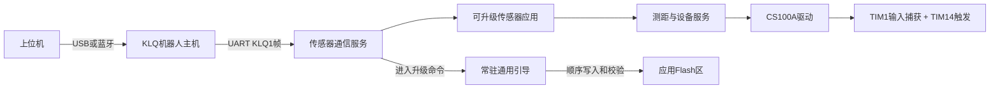
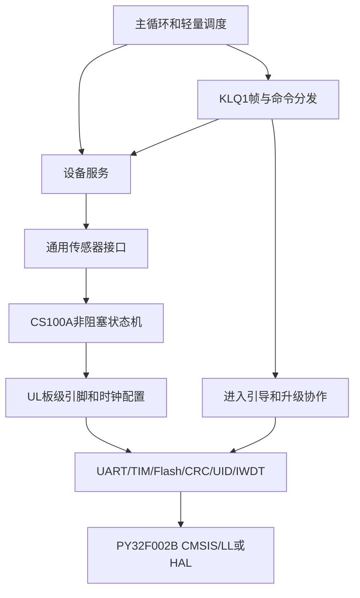
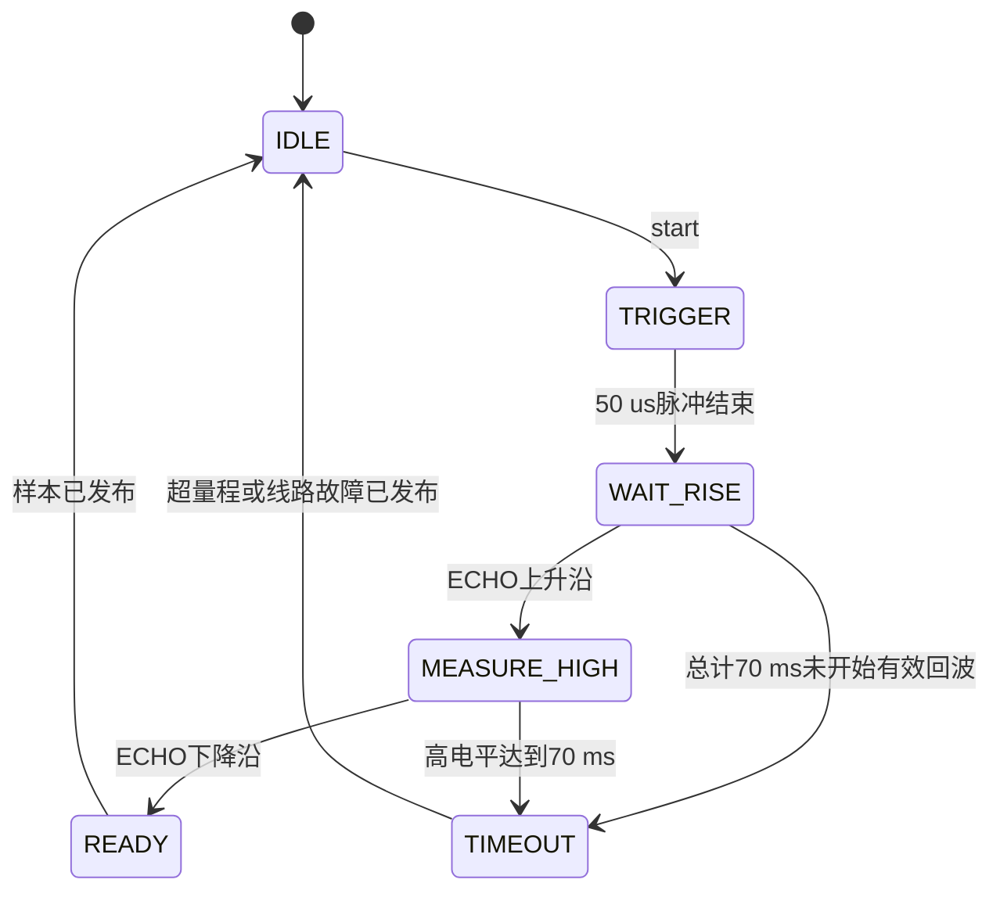
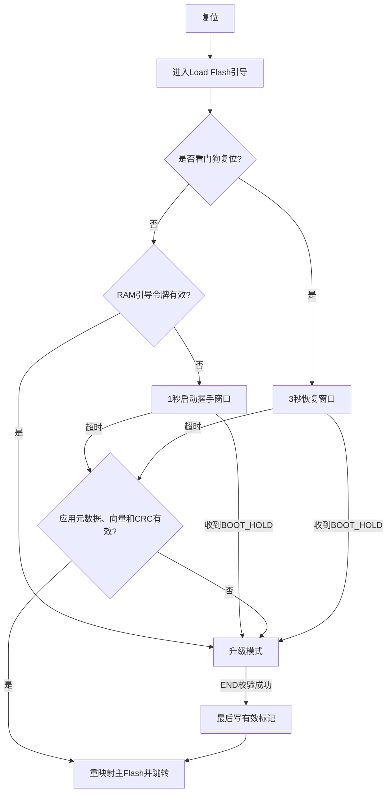
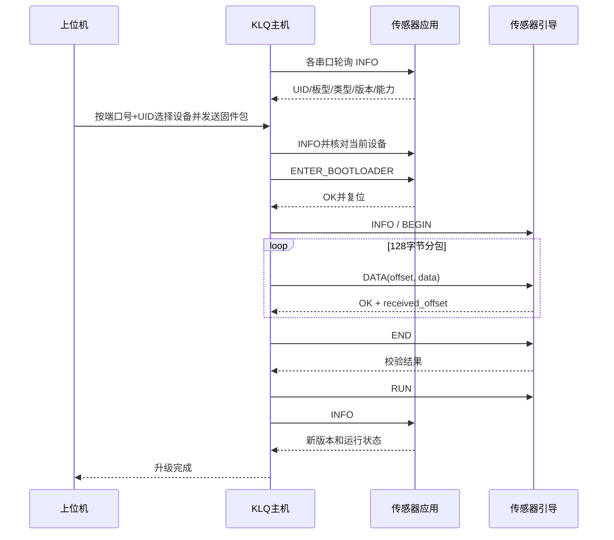

# KLQ 超声波传感器固件架构

版本：V0.2（根据评审意见修订）

日期：2026-09-15

状态：架构基线；应用固件已实现，2026-10-26 增加 PA6 工作指示灯；2026-10-29 共用引导软件已实现并编译/模拟验证，实板待测。当前实现与决策见 [sensor_boot](../sensor_boot/README.md)。

## 1. 目标与范围

本架构面向首个超声波传感器板：`PY32F002BF15U6TR + CS100A`。传感器板通过独立 UART 与 KLQ 机器人主机连接，由主机读取测距数据、查询状态，并在后续通过主机升级传感器固件。

设计同时为后续采用相同或相近 MCU 的传感器板提供可复用底层。新增传感器原则上只替换板级配置和传感器驱动，不重新实现串口帧、设备信息、升级状态机、Flash 写入和测试工具。

本文保留整体架构和升级规划。当前应用实现与构建方法见 [firmware/README.md](firmware/README.md)，精确通信字段见 [docs/klq_sensor_protocol.md](docs/klq_sensor_protocol.md)；规划中的引导功能不能视作已经实现。

## 2. 已核实的输入

### 2.1 硬件 IO

来源：[ul_io分配.xlsx](ul_io分配.xlsx)。当前表中部分中文字符已保存为乱码，以下按可识别的引脚名和信号名整理。

PA6 为用户在 2026-10-26 补充的硬件分配，原始工作簿尚未包含此项；当前以本文和板级代码为准。

| MCU 引脚 | 分配 | 架构用途 |
| --- | --- | --- |
| PA0 | CS100A ECHO 输入 | TIM1_CH1 输入捕获，测量回波高电平宽度 |
| PA5 | CS100A TRIG 输出 | GPIO 或 TIM14_CH1 单脉冲输出，建议用硬件定时产生 50 us 高电平 |
| PA6 | 工作指示 LED 输出 | 高电平亮；正常 1 Hz 短闪，持续回波异常或样本停滞时 5 Hz 快闪（2026-10-26 新增） |
| PA3 | UART TX | 传感器向 KLQ 主机发送数据 |
| PA4 | UART RX | 接收 KLQ 主机命令和升级数据 |
| PA2 | SWCLK | 首次烧录和调试 |
| PB6 | SWDIO | 首次烧录和调试 |

PY32F002BF15U6 官方资料给出的资源是 Cortex-M0+、最高 24 MHz、24 KiB Flash、3 KiB SRAM、1 路 USART、TIM1、TIM14、硬件 CRC-32 和唯一 UID。PA0、PA3、PA4、PA5 的定时器和 USART 复用功能与当前 IO 分配相符。芯片资源有限，因此升级协议不能照搬主机端 1028 字节的大接收缓冲。

### 2.2 CS100A 约束

来源：[CS100A芯片手册V1.1.pdf](CS100A芯片手册V1.1.pdf)。

| 项目 | 手册值 | 固件设计值 |
| --- | --- | --- |
| TRIG 高电平 | 大于 10 us，建议约 50 us | 50 us 硬件定时脉冲 |
| 发射 | 8 个 40 kHz 脉冲 | 由 CS100A 自动完成 |
| 距离换算 | `高电平时间 × 340 m/s ÷ 2` | 同时保留原始脉宽和换算后的毫米值 |
| 超量程 ECHO | 高电平约 66 ms | 70 ms 最坏超时 |
| 下一次测量 | 上一次 ECHO 高电平结束后 | 自适应最大速率：本次完成后保留 1 ms 防重触发间隔再立即启动下一次 |
| 量程 | 8 m | 超量程单独上报，不伪装成 8 m |
| 盲区 | 小于 2 cm | 小于有效下限的数据标记为过近或无效 |
| 精度 | 0.1 cm + 1% | 驱动不承诺高于芯片规格的精度 |
| 供电 | 3 V - 5.5 V | PY32F002B、CS100A 与 KLQ 主机 UART 均为 3.3 V，电源和电平处理已完成 |

### 2.3 已确认的系统约束

- 传感器、CS100A 和 KLQ 主机 UART 均使用 3.3 V，不再增加电平转换相关的软件或硬件前置条件。
- KLQ 的三个外接串口均可连接传感器或电机，不为超声模块指定固定端口。每一路是独立点对点 UART，由主机逐端口发现设备类型。
- KLQ 主机不能单独控制传感器断电或硬件复位，连接只有电源、TX、RX 和 GND。在线升级依赖应用软件复位；应用失控后的恢复依赖传感器独立看门狗。
- 主机与传感器之间此前没有既定业务协议。本架构确定采用第 5 节定义的协议，不再等待外部协议输入。
- 首版按资源受限设备的常规方案采用目标兼容检查和 CRC-32，不加入镜像签名或 HMAC；KLQ 主机是升级信任边界。
- CS100A 采用自适应连续测量，在芯片允许的时序内尽可能提高采样率。主机读取最新样本，不要求每个样本都通过 UART 主动上报。
- 不做出厂距离标定、温度补偿或参数持久化，使用 CS100A 默认精度和手册换算关系。

## 3. 总体设计



架构分成三个稳定边界：

1. **主机协议边界**：传感器只识别带长度、序号和 CRC 的二进制帧，不输出无封装文本。KLQ 主机负责设备发现、业务轮询和升级编排。
2. **通用固件底层**：UART、定时器、Flash、CRC、UID、看门狗、帧解析和升级流程与具体传感器解耦。
3. **传感器应用层**：CS100A 只通过标准 `sensor_ops` 接口向设备服务提供启动测量、轮询、读取结果、自检和配置能力。

## 4. 固件分层



### 4.1 平台层 `platform/py32f002b`

- 时钟、复位原因、SysTick 或单调毫秒计数。
- USART 中断收发、RX/TX 环形缓冲和错误统计。
- TIM1 输入捕获、TIM14 单脉冲、GPIO 和引脚复用。
- Flash 128 字节页擦写、读回校验、区域边界保护。
- 硬件 CRC-32、UID、独立看门狗和软件复位。
- 中断中只记录时间戳或搬运字节，协议解析和业务回调放在主循环。

### 4.2 公共服务层 `common`

- `frame_codec`：字节流重同步、长度检查、CRC、序号和响应编码。
- `command_router`：公共命令与传感器命令分发。
- `device_info`：设备类型、硬件版本、固件版本、能力位和最大载荷。
- `update_client`：应用收到进入引导命令后安全复位。
- `sensor_if`：所有传感器实现统一接口。
- `fault`：复位原因、UART 错误、测量超时和看门狗次数的统计快照。

建议的通用接口职责如下，具体 C 头文件在架构确认后再定：

| 接口 | 含义 |
| --- | --- |
| `init` | 初始化板载传感器，不得无限等待 |
| `start` | 启动一次采样；忙时返回明确状态 |
| `poll` | 推进非阻塞状态机 |
| `get_sample` | 返回最近一次样本、时间戳和质量状态 |
| `configure` | 设置允许公开调整的参数 |
| `self_test` | 执行有界自检并返回分项结果 |

### 4.3 CS100A 驱动层

驱动不使用阻塞式 `delay_ms(70)` 等待回波，而是通过定时器和状态机工作。这样在最远距离或无目标时，UART 命令、升级请求和看门狗仍可正常处理。



建议 TIM1 以 500 kHz 计数，即每计数 2 us，16 位范围约 131 ms，覆盖 66 ms 超量程脉冲且无需软件扩展溢出。PA0 使用输入捕获记录 ECHO 两个边沿。PA5 优先使用 TIM14_CH1 单脉冲产生 50 us TRIG；若当前 SDK 对单脉冲支持不完整，再使用定时器比较中断控制 GPIO，不能依赖不确定执行时间的软件空循环。

每个样本至少包含：

```text
sample_seq, capture_time_ms, echo_ticks, distance_mm,
status, quality_flags
```

状态区分 `VALID`、`TOO_CLOSE`、`OUT_OF_RANGE`、`NO_ECHO`、`BUSY` 和 `HW_FAULT`。距离换算使用整数运算，原始 ECHO 计数同时返回，便于主机复核。

应用默认进入自适应连续测量：ECHO 下降沿或本次 70 ms 超时后，保留 1 ms 防重触发间隔便启动下一次测量，不设置固定 100 ms 周期。按 340 m/s 估算，8 m 回波约 47 ms，更新率约 20 Hz；超量程最坏约 14 Hz；近距离更新率更高。1 ms 是首版抑制余振和重复触发的工程保护值，实板用示波器和重复性数据验证后可在不降低稳定性的前提下缩短，但不违反“上一次 ECHO 结束后才能开始下一次”的芯片约束。

测量与 UART 解耦。驱动持续刷新“最新样本”，主机按需要读取；可选中值滤波只生成附加结果，不覆盖原始样本和错误状态。首版不保存距离偏置或温度补偿参数。

## 5. 串口通信协议草案

### 5.1 物理层

首版确定使用 `115200 bit/s, 8N1, 无硬件流控, 全双工 UART`，与 KLQ 主机当前三个外接端口的初始化值一致。每个端口是独立点对点链路，不需要总线地址。主机在所有外接端口周期发送公共 INFO，自动识别传感器或电机；设备拔插后重新发现，不绑定固定物理端口。

### 5.2 帧格式

复用主机已经实现和验证的 `KLQ1` 小端帧：

```text
"KLQ1" | sequence:u32 | command:u16 | payload_length:u16 | crc32:u32 | payload
```

- CRC-32 覆盖头部前 12 字节和 payload，与主机当前 `zlib.crc32` 规则一致。
- 响应命令号为请求命令号 OR `0x8000`，响应 payload 前 4 字节为状态码。
- 主机一次只保持一个未完成请求。超时可用相同序号和完整请求重发。
- 设备缓存上一条有效请求的完整响应，避免升级数据或配置被重复执行。
- 传感器端首版最大请求 payload 确定为 **132 字节**：4 字节 DATA 偏移加一整页 128 字节固件数据。该能力由 INFO 返回，主机不得假定现有 USB 协议的 1028 字节上限。
- 解析器遇到乱码、坏 CRC、超长包或超时半包时回到搜索 `KLQ1` 魔数状态。
- 正式固件禁止在同一 UART 裸发调试字符串；日志必须是协议事件或仅在 SWD 调试构建中启用。

### 5.3 命令空间

公共引导命令确定复用现有编号，减少 KLQ 主机升级代码分支：

| 命令 | 编号 | 模式 | 说明 |
| --- | ---: | --- | --- |
| INFO | `0x0001` | 引导/应用 | 返回设备、版本、能力、最大载荷和运行模式 |
| BEGIN | `0x0002` | 引导 | 声明目标、硬件兼容号、镜像长度、版本和 CRC |
| DATA | `0x0003` | 引导 | 4 字节顺序偏移 + 最多 128 字节数据，总 payload 不超过 132 字节 |
| END | `0x0004` | 引导 | 整包校验并最后提交有效标记 |
| RUN | `0x0005` | 引导 | 校验有效应用后运行 |
| ECHO | `0x0006` | 引导/应用 | 链路诊断 |
| RESET | `0x0007` | 引导/应用 | 软件复位 |
| BOOT_HOLD | `0x0009` | 引导 | 在看门狗恢复窗口内要求引导保持在线 |

应用命令建议单独划分：

| 命令 | 建议编号 | 说明 |
| --- | ---: | --- |
| GET_SAMPLE | `0x0101` | 读取连续测量产生的最近样本，不触发新的阻塞测量 |
| SET_CONFIG | `0x0102` | 设置允许公开调整的滤波或调试参数；首版参数不写 Flash |
| GET_STATUS | `0x0103` | 运行状态、错误计数和复位原因 |
| SELF_TEST | `0x0104` | 执行 UART/定时器/回波线路的有界自检 |
| START_STREAM | `0x0110` | 可选，启动协议化低速事件流 |
| STOP_STREAM | `0x0111` | 停止事件流 |
| ENTER_BOOTLOADER | `0x01F0` | 应答后写入 RAM 引导令牌并软件复位 |

主机默认轮询 `GET_SAMPLE`，不依赖主动流。主动流保留为调试能力，事件命令放在 `0x4000-0x4FFF`，防止与请求和响应混淆。主机即使降低轮询频率，也不会降低传感器内部采样率，只会跳过中间样本。

协议字段、命令号和状态码在写固件前需要形成一份主机与传感器共用的单一协议文件或生成源，禁止两边手工维护两份不一致的枚举。

## 6. 可升级引导设计

2026-10-29 实施决定：本节下面保留的 Load Flash、RAM 令牌和看门狗窗口属于旧规划。当前三类 PY32 板统一使用主 Flash 低地址 6 KiB 引导、应用起点 0x08001800、末页 0x08005F80；不修改选项字节。普通复位 500 ms 窗口，ENTER 应答后复位并由主机及时 HOLD，无 RAM 令牌或看门狗救援。固定 SDK 支持 VTOR，应用在 SystemInit 后重设 VTOR。已实现应用内部板型/兼容号/ABI 检查；以 [统一协议](../sensor_boot/docs/protocol_v1.md) 为当前开发依据。主控USB转发及自动HOLD已接入并通过软件链路测试，实际板测仍未完成。

### 6.1 采用 Load Flash 常驻引导

PY32F002B 可把主 Flash 末尾最多 4 KiB 配置成 Load Flash，并在启动时映射到 `0x00000000`。建议量产配置固定使用 4 KiB Load Flash，配合写保护，使传感器每次复位先进入通用引导，再由引导决定进入应用或停留升级。

建议分区：

| 区域 | 地址 | 大小 | 用途 |
| --- | --- | ---: | --- |
| 应用镜像 | `0x08000000-0x08004F7F` | 20,352 B | 向量表、通用应用和具体传感器驱动 |
| 应用元数据 | `0x08004F80-0x08004FFF` | 128 B | 长度、CRC、版本、目标兼容号和最后提交标记 |
| Load Flash 引导 | `0x08005000-0x08005FFF` | 4,096 B | UART、KLQ1 最小解析、Flash 更新、校验和跳转 |

引导在跳转应用前把主 Flash 重映射到 `0x00000000`，关闭自身使用的中断和定时器，设置 MSP 后跳到应用复位向量。该流程必须先用官方 SDK 和实板验证；Cortex-M0+ 项目不能直接照搬 APM32E103 的 VTOR 跳转代码。

### 6.2 启动判定



正常在线升级：主机向应用发送 `ENTER_BOOTLOADER`，应用停止测量和发送，回复成功，写入带反码或 CRC 的 RAM 引导令牌，然后软件复位。引导消费并清除令牌后留在升级模式。

应用损坏时：引导发现元数据、向量或 CRC 无效，永久停留升级模式，主机可重试下载。

应用有效但通信失控时：由于 KLQ 主机没有传感器断电或硬件复位控制，应用必须尽早启动独立看门狗，并仅在主循环、通信解析和传感器状态机均正常推进后喂狗。看门狗复位后，引导先开放 3 秒恢复窗口；主机的端口服务检测到引导 INFO 后发送 `BOOT_HOLD`，使引导持续等待升级。若窗口内没有保持命令且应用仍有效，引导重新运行应用，避免一次偶发复位让设备永久离线。若实板确认 SRAM 在看门狗复位后保持，则再增加连续复位计数，连续 3 次看门狗复位后直接停留引导；若 SRAM 不保持，不用 Flash 频繁记录复位次数，仍采用每次 3 秒恢复窗口。

普通上电和无令牌的软件复位统一开放 1 秒启动握手窗口，主机在端口发现阶段可发送 `BOOT_HOLD`。这会增加约 1 秒冷启动时间，但可在应用仍喂狗却无法通信时，通过整机或传感器电源重新上电获得一次救援入口；具体窗口可在联调确认主机最坏启动时间后缩短。RAM 引导令牌只用于已收到 `ENTER_BOOTLOADER` 的受控软件复位，令牌带魔数、反码和原因字段，引导读取后立即清除，防止随机 SRAM 导致误判。

仍需明确接受一个硬件边界：若应用串口失效但仍持续喂狗，仅靠 UART 无法强制 MCU 进入引导。当前串口 1～3 采用外接端子，极端情况下可人工拔插端子使传感器重新上电，并由主机在普通复位的 1 秒监听窗口内持续发送 `BOOT_HOLD` 进入引导。该方式可作为现场恢复手段，但需要人工介入，不属于主机全自动远程恢复；若未来要求无人值守恢复，硬件仍需增加复位控制线或可控电源。

### 6.3 下载事务

1. `INFO` 确认当前处于引导、设备类型、硬件兼容号、最大镜像和最大分包。
2. `BEGIN` 校验目标和长度，先擦除应用元数据使旧镜像失效，再按 128 字节页擦除所需应用区。
3. `DATA` 只接受从偏移 0 开始的连续写入；每页按 PY32 要求使用 32 位、整页编程流程，完成后读回核对。
4. 相同序号和数据的重发返回缓存响应，不重复写入；偏移跳跃、倒退或数据变化均拒绝。
5. `END` 计算整个应用 CRC，检查初始栈位于 SRAM、复位向量为应用范围内的 Thumb 地址，并核对目标兼容号。
6. 所有检查通过后写元数据，**最后一个 32 位字写有效提交标记**。断电发生在此之前，应用始终无效。
7. `RUN` 再次校验后跳转应用。失败时保持引导在线，不自动运行残缺镜像。

该芯片容量不适合双应用槽，因此首版没有旧版本回滚。安全目标是“升级失败仍能再次升级”，不是“升级失败自动回到旧版本”。

### 6.4 固件包和兼容检查

上位机或 KLQ 主机持有的传感器升级包建议包含：

```text
container_magic, format_version, board_id, hw_compat,
fw_version, image_length, image_crc32, build_id, image
```

容器头不写入应用起始地址，应用仍从标准向量表开始。引导把必要字段保存到末尾元数据页。

当前硬件没有板型识别电阻或其他自动识别输入，因此采用**编译期板型配置**：引导代码保持通用，但每种传感器板的首次 SWD 量产镜像写入固定 `board_id` 和 `hw_compat`。超声板首版暂定 `board_id = 0x0001`、`hw_compat = 0x0001`，正式协议登记时固化。后续其他传感器即使使用同一 MCU，也生成带不同板型常量的引导量产镜像。

引导负责区分和保护硬件目标：INFO 返回自身固定的 `board_id/hw_compat`，BEGIN 必须与固件包目标完全匹配，否则在擦除前拒绝。应用负责区分业务能力：公共 INFO 额外返回 `device_class`、`sensor_type`、应用版本和能力位，KLQ 主机据此选择超声、其他传感器或电机驱动。应用镜像中也保存目标板型，END 时由引导复核。因此“不识别”不是运行时猜测硬件，而是在首次烧录时为每类板写入明确身份。

首版至少检查 `board_id + hw_compat + image_length + image_crc32`，防止把其他传感器或其他硬件版本的镜像刷入。CRC 只能防传输和存储损坏，不能证明镜像来源；首版把 KLQ 主机作为可信升级入口，不在 4 KiB 引导中加入 HMAC 或签名。容器格式保留认证扩展字段，后续安全要求提高时再升级格式版本。

## 7. KLQ 主机侧协作边界

主机后续需要增加 `sensor_port_service`，每个外接 UART 端口独立维护设备状态和请求序号。传感器升级由主机编排，PC 上位机不直接假定某个物理串口。



主机端必须做到：

- 升级期间暂停该端口的普通测量轮询和电机/传感器业务。
- 对所有可外接 UART 使用相同的 INFO 探测流程，不预设某一路只能接传感器或电机；设备上下线后重新发现。
- 主机内部以 `(port_id, UID)` 标识一次连接，上位机升级目标同时携带端口号和 UID，开始擦除前再次核对，避免设备换插后刷错目标。
- 从 INFO 读取最大载荷、镜像上限和能力，不把 USB 引导参数硬编码到传感器端。
- 支持从 PC 到传感器的流式转发，主机只需保留一个分包，无需先把整个传感器镜像写入主机内部 Flash。
- 断线、超时或主机复位后可重新识别设备是应用模式还是引导模式，并从 BEGIN 重新升级。
- 应用失联时继续按端口探测引导 INFO；若命中看门狗恢复窗口且需要救援，立即发送 BOOT_HOLD，再开始升级。
- 升级前后核对 `board_id`、`hw_compat`、`UID` 和 `fw_version`，把失败阶段和状态码返回上位机。

## 8. SRAM 和 Flash 预算

以下是架构门槛，不是最终链接结果：

| 项目 | 目标预算 |
| --- | ---: |
| Load Flash 引导代码 | 不超过 4,096 B |
| 应用代码和只读数据 | 不超过 20,352 B |
| 引导静态 RAM | 不超过 1,024 B |
| 应用静态 RAM | 不超过 1,536 B |
| 最坏栈预留 | 至少 768 B |
| 堆 | 默认禁用 |
| UART RX 环形缓冲 | 256 B 以内 |
| 单帧工作缓冲 | 约 160 B，按 132 B 最大 payload 设计 |

每次构建必须生成 map 文件并在脚本中检查分区越界、静态 RAM 和栈余量。公共层避免 `printf`、浮点运算、动态内存和大型 HAL 依赖；距离计算、版本编码和协议字段均用定长整数。

## 9. 建议目录结构

后续代码全部放在 `UL` 下，与主机固件隔离：

```text
UL/
  docs/
    ultrasonic_firmware_architecture.md
    klq_sensor_protocol.md
    bringup_and_test.md
  firmware/
    boards/
      ul_v1/
        board.h
        board.c
    common/
      frame_codec.*
      command_router.*
      device_info.*
      sensor_if.h
    platform/
      py32f002b/
        clock.*
        uart.*
        timer.*
        flash.*
        crc.*
        reset.*
    bootloader/
      main.c
      update_protocol.*
      image_validate.*
    app/
      main.c
      sensor_service.*
      sensors/cs100a.*
    vendor/
      PY32F002B_Firmware/
    linker/
      bootloader.*
      application.*
  tools/
    build_sensor.py
    package_sensor.py
    test_sensor_protocol.py
  tests/
    unit/
    hardware/
```

公共协议字段和状态码建议从一个机器可读定义生成主机 C 头文件、传感器 C 头文件和 Python 测试常量，或至少放在仓库唯一公共头文件中。避免主机与传感器各自复制命令枚举。

## 10. 验证计划

### 10.1 协议和升级

- CRC 已知向量、0/1/127/128/131/132 字节 payload 边界、坏长度、坏 CRC、半包超时和魔数重同步。
- 相同请求重放、相同序号但内容不同、DATA 偏移跳跃和越界镜像。
- 错误 `board_id`、错误硬件兼容号、错误整包 CRC、错误栈地址和错误复位向量。
- 在 BEGIN、擦除、每个 DATA 页、END 校验和提交标记前后模拟断电；每次恢复后只能进入有效应用或可通信引导。
- 应用卡死后由看门狗复位，主机须能在 3 秒窗口内用 BOOT_HOLD 留在引导并重新升级；同时验证 UART 噪声不会误触发保持。
- 引导区写保护实测，应用更新命令不能擦除或写入 `0x08005000-0x08005FFF`。

### 10.2 CS100A

- 示波器核对 TRIG 高电平 50 us，并核对每次 ECHO 结束或 70 ms 超时后约 1 ms 再触发。
- 信号源或实际探头核对 ECHO 上升沿、下降沿、2 cm 附近、典型距离和约 66 ms 超量程。
- 串口持续通信期间反复测距，确认中断延迟不丢边沿。
- 对固定距离采集原始脉宽、毫米值、重复性和错误率，不只观察滤波结果。
- 传感器断开、ECHO 常低、ECHO 常高和噪声毛刺均在 70 ms 内恢复，不阻塞主循环。

### 10.3 资源和长稳

- 引导和应用分别检查 Flash、静态 RAM、最大栈深和中断栈余量。
- 24 小时测距与主机轮询，看门狗、UART 错误计数和测量序号连续。
- 至少 100 次应用到引导、升级、运行循环；升级前后 UID 和硬件兼容号保持一致。

## 11. 已确认决定与剩余工程验证

### 11.1 已确认的产品决定

| 项目 | 已确定方案 |
| --- | --- |
| 供电与 IO 电平 | PY32F002B、CS100A 和 KLQ UART 均为 3.3 V，电源及电平已由硬件处理 |
| 连接端口 | KLQ 任意外接串口均可连接传感器或电机，由主机逐端口发现，不固定端口类型 |
| 复位条件 | 主机没有传感器复位和独立供电控制，只使用串口；正常升级由应用软件复位，异常恢复依赖独立看门狗，并在普通复位/看门狗复位后分别开放 1 秒/3 秒引导窗口 |
| 板型识别 | 不做运行时硬件猜测；首次 SWD 烧录时将编译期 `board_id/hw_compat` 固化在引导中，应用另报业务类型和能力 |
| 通信协议 | 采用本文定义的 KLQ1、115200 8N1、132 字节最大 payload 和逐端口 INFO 发现 |
| 升级安全 | 首版采用板型/硬件兼容检查、UID 复核及 CRC-32；不在 4 KiB 引导中加入签名或 HMAC |
| 数据方式 | 传感器自适应连续测量并尽可能提高稳定采样率；主机读取最新样本，主动流仅作调试能力 |
| 标定 | 首版不做出厂标定、温度补偿或持久化标定参数，按 CS100A 默认规格输出 |

### 11.2 开发阶段必须实测关闭的风险

以下不再需要产品侧选择，但必须在实板 bring-up 阶段验证，验证失败时要回到架构评审：

1. **Load Flash 启动链**：确认 4 KiB Load Flash 配置、写保护、主 Flash 重映射和 Cortex-M0+ 跳转流程在量产选项字节下均可靠。
2. **复位恢复链**：确认主机能在共同上电后的 1 秒普通启动窗口内完成端口探测，并确认 IWDG 复位原因可识别、3 秒恢复窗口能被稳定捕获及 RAM 在 IWDG 复位后的保持情况。若 RAM 不保持，则取消连续复位计数，只保留每次 IWDG 复位的 3 秒 BOOT_HOLD 窗口，避免为计数频繁擦写 Flash。
3. **4 KiB 引导容量**：首次可链接版本必须用 map 文件验证大小；若超限，优先删除引导中的非必要诊断和完整响应缓存，不削弱目标检查、断电安全及恢复能力。
4. **最大稳定采样率**：1 ms 防重触发间隔是起始值，需要在近距离、8 m、超量程和多模块相邻工作条件下验证余振及串扰，再确定量产最小间隔。
5. **主机发现时序**：联调时确定 INFO 探测周期、请求超时和热插拔去抖的具体数值；设备身份固定使用 `(port_id, UID)`，不再引入端口类型配置。

## 12. 建议的实施顺序

架构确认后建议按以下里程碑开发，每一步都保留可单独验证的产物：

1. 建立官方 SDK、链接脚本、SWD 烧录和最小 UART 回显工程。
2. 实现并实测 4 KiB Load Flash 引导、主 Flash 重映射和空应用跳转。
3. 完成 KLQ1 传感器协议公共层及主机侧测试工具。
4. 完成应用在线进入引导、看门狗恢复窗口和 BOOT_HOLD 救援升级测试。
5. 完成 CS100A 定时器驱动、原始脉宽和单次测距。
6. 接入设备服务、主机轮询、状态与可选滤波。
7. 主机与传感器联合升级、异常注入、长稳、默认精度和最大稳定采样率验证。

## 13. 参考资料

- 项目 IO：[ul_io分配.xlsx](ul_io分配.xlsx)
- CS100A：[CS100A芯片手册V1.1.pdf](CS100A芯片手册V1.1.pdf)
- KLQ 主机当前架构：[../docs/architecture_current.md](../docs/architecture_current.md)
- KLQ 主机 USB 引导协议：[../README_BOOTLOADER.md](../README_BOOTLOADER.md)
- PY32F002B 官方产品页：[Puya PY32F002BF15U6](https://www.puyasemi.com/en/py32f002b/2561.html)
- PY32F002B 资料索引：[OpenPuya PY32F002B Series](https://py32.org/en/mcu/PY32F002Bxx)
- PY32F002B 参考手册：[PY32F002B Reference Manual](https://download.py32.org/ReferenceManual/en/PY32F002B_Reference_Manual_V1.0.pdf)
- PY32F002B SDK：[OpenPuya/PY32F002B_Firmware](https://github.com/OpenPuya/PY32F002B_Firmware)
