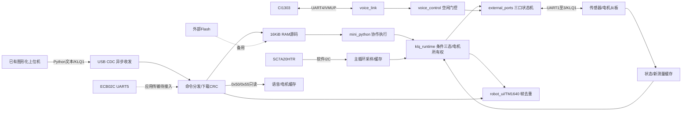

# KLQ机器人当前架构

当前主机：0.14，2026-10-30已通过主机USB安装；驻留BOOT仍为0.3。本轮优化与验证范围见[0.14优化记录](optimization_014.md)。0.13的P2 Python电机实物记录继续保留在[历史验收](verification_20261030_python_motor.md)，不代表本轮重新验证了所有机械动作。

## 1. 系统与存储边界

- MCU：APM32E103RET6；当前时钟72MHz，16MHz外部晶振，USB48MHz。
- 系统固件包含通信、驱动、解释器和状态服务，写MCU内部Flash；用户Python文本只存16KiB静态RAM，不写内部Flash，外部Flash备用。
- 完成、停止、运行错误后保留完整源码；下次BEGIN覆盖，MCU复位或断电清空。外部Flash是否用于用户程序掉电保存尚未决定。
- 正常使用通常不接USB。主机独立运行已下载程序，USB用于下载、更新和观测；没有USB或电脑未读数据，不应阻塞本机服务或结束完整用户程序。
- 上位机已有，只需生成[积木API](python_api_v0.1.md)和实现[下载协议](host_usb_protocol_v0.1.md)。轮询、调度、串口事务、去抖、超时和故障退出由主机负责。
- 允许完全不接外设，也允许多个相同传感器或电机。用户程序只检查实际调用的端口、内置设备及其拥有的电机；其他空口或同型设备不会构成全局错误。

## 2. 硬件边界

| 功能 | MCU接口 | 当前状态 |
|---|---|---|
| 电源保持 | PC5 | C运行库初始化前拉高；软件关机拉低 |
| 电源键 | PC4 | 上拉低有效；短按运行/停止，长按1.5秒开/关机；菜单确认待实现 |
| 用户按键 | PC3 | 20ms去抖、wait_button；启动APP早期还可保持低40ms请求进入BOOT |
| USB CDC | PA11/PA12 | 系统更新、RAM源码下载、状态观测 |
| LED点阵 | PB6/PB7，TM1640 | 7×13映射、开机动画、双眼待机、系统/用户图案；映射方向已有实物确认 |
| 加速度计 | PB8/PB9，SC7A20HTR | 软件I²C、三轴与Roll/Pitch后台缓存 |
| 外接端口1 | PA9/PA10，USART1 | 独立发现、传感器/电机业务、排他升级 |
| 外接端口2 | PA2/PA3，USART2 | 同上；0.13 P2 N20机械动作已有历史验收 |
| 外接端口3 | PB10/PB11，USART3 | 同上；当前接线每次联调重新确认 |
| 内置音频 | PC10/PC11，UART4 | CI1303 VMUP V0.2；版本、音效和语音事件 |
| ECB02C蓝牙 | PC12/PD2，UART5；PA8连接状态 | UART初始化；连接状态/应用传输协议待接入 |
| 电池采样 | PA0 ADC | IO已定，采样换算及低电量策略待实现 |
| 外部Flash | PB12～PB15，SPI | 备用，用户程序持久化未定 |
| USB插入检测 | PB4 | IO表标为备用，检测逻辑未实现 |
| SC7中断 | PB3/PB5 | INT1/INT2未使用，周期读取 |
| 调试接口 | PA13/PA14，SWD | 保留DAPLink恢复路径 |

仅靠DAPLink给MCU供电，不能推定外接端口或MOS后的负载正常供电。此前无电池导致传感器未供电，独立供电后恢复的记录见[端口验证](verification_20260915_external_ports.md)。软件在线/停止状态与实际电源、电机动作需分别验证。

## 3. 固件构建与Flash

bootloader目录存放共享平台和系统源码，由KLQ_DEMO_APP选择构建边界；目录名不表示所有代码都属于引导。

| 构建 | 基址 | 用途 |
|---|---|---|
| tools/build.py | 0x08000000 | 最小BOOT、USB、显示、电源与系统镜像更新 |
| tools/build.py --demo | 0x08008000 | 实际机器人系统固件，含RAM解释器与业务驱动 |

| Flash区域 | 地址 | 大小 |
|---|---|---:|
| BOOT | 08000000..08007FFF | 32KiB |
| 系统APP槽 | 08008000..0807F7FF | 478KiB |
| 镜像元数据 | 0807F800..0807FFFF | 2KiB |

BOOT先使元数据失效，按连续偏移写APP；END检查CRC和向量后提交有效magic。单槽不自动回滚，失败留BOOT重新下载。APP中的BEGIN/DATA/END只操作RAM文本，不包含系统Flash擦写路径。

当前驻留BOOT0.3未改。源码BOOT已构建回归，未安装；不能把APP0.14的USB、看门狗或故障恢复改动说成驻留BOOT也已升级。当前USB协议不更新BOOT本身。

## 4. 启动、电源与故障恢复

SystemInit在C库初始化前拉高PC5。BOOT冷上电要求PC4持续1.5s；软件复位可绕过冷启动门槛。正常通过镜像校验后跳APP，跳转前关闭USB/SysTick、清NVIC、设置VTOR/MSP。APP早期检测PC3低电平持续40ms时，请求进入BOOT，供业务异常时恢复下载。

APP初始化后播放开机动画并进入双眼待机。PC4短按在READY/RUNNING间切换；空RAM短按显示X。长按1.5s先取消用户/语音/升级并请求电机停止，最多等待150ms；随后立即detach USB、清屏并拉低PC5，已移除旧路径额外固定300ms等待。这是软件顺序，未做电气断电时序注入或实测。

USB/DAP可能绕过MOS使MCU继续供电。关机循环要求先松键，再新长按1.5s复位唤醒；该循环继续喂看门狗。仅拔掉USB若导致MCU失电，RAM程序仍按断电规则丢失。

APP以软件方式使能独立看门狗IWDT，按LSI标称40kHz配置约2s；实际周期受LSI影响，不能当作精确2s。正常主循环推进到关键服务之后每约250ms喂狗，不在定时中断盲喂；保护从看门狗实际启用后生效。INFO的SYS_WDT=1表示本次APP已使能。0.14实板已确认该标志、RESET回驻留BOOT0.3后稳定6s以及再RUN返回APP，未注入主循环挂死或真实Fault。

强Fault向量切回预设栈顶记录异常号、PC、LR、CFSR和校验，然后请求复位到BOOT，不在Fault路径调用USB/UART。RAM顶端保留32B：2001FFE0..2001FFF7为24B故障记录，2001FFF8..2001FFFF为兼容旧BOOT的8B请求。记录只跨保留RAM的复位存在，不写Flash；INFO提供SYS_FAULT/SYS_PC。驻留旧BOOT0.3会清复位标志，因此看门狗复位原因日志仍不能保证完整。看门狗与Fault恢复不是电气硬停；电机从板的软件失联保护也不能替代硬件失能验收。

## 5. 主循环与时间约束

0.14主循环先处理取消、到期事务和电机租约，再推进用户代码：

1. power_key_poll、voice_link_poll，设置运行采样模式并调用external_ports_poll。
2. protocol_poll、再次检查电源键、voice_control_poll及CI版本查询。
3. 更新用户按键，user_program_poll推进有限语句，robot_ui_poll处理显示，主循环喂狗。
4. 非排他升级期间按期限读取SC7；只有CDC控制线与日志槽允许时才组织低优先级日志。错过周期不突发补发。

VM每次最多一条语句、内部跳转预算32；合法的无延时循环由协作推进，不能作为程序错误拒绝下载。USB接收每轮256B；回复使用固定缓冲和异步游标，整个发送任务到250ms仍未完成则失败并回收，不在等待中递归调用业务。INFO使用已验证镜像的缓存，启动/固件END仍完整校验。以上有界机制不等于已证明所有IRQ、I²C和外设路径的最坏响应时间。

定时积木从命令入队计时，不从SET ACK开始。TM1640保存13B掩码后列数据与valid位，相同画面不重复写总线；初始化强制完整写，熄灭后不同画面正常恢复，没有增加显示刷新限速。

## 6. Python执行与保护范围

mini_python直接扫描RAM中的固定积木子集：字面量、固定函数、for/range、while True和pass；循环栈8层，无AST、堆、变量、表达式、if、函数定义或try/except。END校验传输，语法和参数在RUN检查；错误统一停止电机、报告PY_ERROR/PY_LINE、回READY并保留源码。CR、CRLF、LF的错误行号一致。

每次RUN将motor_power和move_power恢复为2，清除本次运行的等待、循环和电机所有权；保留后台采样缓存和按键去抖状态。程序不调用传感器就不要求连接传感器；访问P1距离时不检查P2/P3，其他同型设备不会误报重复。

距离/倾斜等待分PENDING、TRUE、FAULT三态。距离新测量快照年龄≤80ms，IMU有效年龄≤100ms；新鲜但不满足条件继续等待。距离状态2/3/4（太近/超范围/无回波）也正常等待。指定设备离线、类型错误、未采到样本、过期或故障状态持续250ms才报PY_ERROR7并stop_all；恢复有效测量则清除连续故障计时。wait_button允许无限等待，不套传感器故障超时。

电机异步健康检查只检查当前程序拥有的口，保留所有权直到STOP ACK确认IDLE；未使用口的离线/错误不影响程序。保护触发后全局请求电机停止，避免其他已启动电机续行。wait_ir仍未实现，报6；不能因IR普通采样在线就声称红外积木已交付。

## 7. 端口、采样与电机

- 三口各自固定RX缓冲、一个未完成事务、序号/CRC/超时/重发现；绑定前检查UID/板型/兼容性，拔插清样本缓存。
- 后台采集、静态缓存、API读快照；不在Python调用中同步等UART/I²C。规则见[传感器决策](decisions/001_sensor_access_strategy.md)。
- SC7硬件100Hz，主机待机目标100ms、运行20ms；CS100A待机100ms、运行40ms；双路IR20ms。外接周期从请求开始起算，已到期最多发起一次，不补发积压周期。它们是调度目标，不是保证的测量帧率。
- 首样本显式sample_valid，允许序号/采集时刻为0。之后sequence和capture_time_ms都变化才发布整份新测量并更新sample_host_ms；重复测量只证明通信存活，不刷新测量年龄。年龄按主机接受新测量的发布时间计算，不是两端同步时钟的物理采集时延。
- 先检查事务期限，再解析RX；过期积压回复不能恢复事务或发布新数据，重试使用新传输序号。不存在全口必须在线或同类只能一个的限制。
- 普通电机signed PWM±1000，档位1/2/3为333/666/1000，默认2；约60ms刷新，主机目标租约150ms，子板正常运行时软件失联保护250ms。STOP优先，SET超时不自动重发。
- 驱动轮询及ready/state/command入口先判断本口租约，到期即进入故障并排STOP，不允许换方向命令刷新旧租约来绕过故障；显式停止/新RUN清理后再启动。
- Python/语音使用普通电机驱动；升级/诊断排他占口，开始时停止用户程序和运动，关闭后重新发现，不自动恢复旧动作。0x55只读目标/ACK/状态，不发UART、不改运行状态；ACK不等于机械转速。

## 8. 音频与语音

UART4接CI1303，115200/8N1，VMUP独立解析。voice_link负责固定缓冲、完整tuple（seq/semantic/score）与接收epoch判重；B0重置peer去重状态。0.14移除voice_control中冗余单seq去重，避免peer重启或u8回绕误拒新语义。

工程运动默认禁用、仅存RAM。EMPTY/READY且UI待机、唤醒、版本匹配并无升级/关机/复位占用时才受理有限动作；仅此工程声控为避免目标歧义仍要求恰好一个兼容电机，不限制Python多端口同类设备。RUNNING时语音停止被拒绝，不终止用户程序。系统音效和事件已有历史实物证据；语音不属于当前26项Python积木。

## 9. USB与观测

- 先用INFO区分BOOT与APP，避免把Python文本写入系统Flash。0x40..43为排他外接升级，0x50..54为语音工程命令，0x55为普通电机只读缓存。
- 二进制命令在USB已配置但未置DTR时仍可应答。ASCII日志仅DTR打开、控制台未停用且日志槽空闲时组织/发送；无人读取时不应挤占主循环。
- 完整RAM程序在CDC关闭/重开或USB会话重置时继续自主运行并保留；半包下载取消，旧程序不恢复。MCU复位/失电仍清RAM。
- APP0.14 RESET在应答真正发送完成后提交，应答超时后同序号同帧重试可重新完成动作；源码BOOT RUN也已修复，但当前驻留BOOT0.3未更新该路径。不能只凭ACK推定跳转或擦写已成功。
- 观测页由单一CDC worker读取。CLI前pause且released=true，结束后resume，不能抢占同一串口。前端刷新率或日志行数不能代替传感器采集率。
- 本轮0.14通过无延时显示程序跨软件CDC close/reopen、完整READY保留、半包取消、STOP及INFO/ECHO；Windows DTR0下INFO及1024B ECHO也通过。另有电机CDC关闭约0.468s后仍ACTIVE/goal1000，重连STOP后目标/ACK归零；这是驱动状态证据，不冒充机械转速验收。
- 用户随后确认当前供电接线下物理拔USB仍显示12，PC4短按STOP/RUN与重连正常；重连INFO为USER_VALID1/PY_ERROR0/SYS_WDT1，PK_SHORT增2。该实物观察与软件close测试分别记录；未抓取0x22控制请求，不据此外推实际失电或所有供电接法。

## 10. 资源与验收边界

0.14最终APP BIN32980B、RO32912B、RW/ZI27888B，相比0.13增加Flash2028B/RAM256B，包含16KiB源码及2KiB栈，无动态分配。RAM顶端32B另行保留，不能分配为普通数据或栈。静态调用图不能替代栈水位、IRQ最坏路径和长时间板测。

本轮已安装最终0.14，确认SYS_WDT=1、驻留BOOT0.3稳定与RUN返回、CDC/RAM保留及用户物理拔USB观察。错误类型口距离等待实板报7/第2行，电机调用报6/第2行，后续仍可下载。0.13的P2正反转/定时/停止是历史机械验收；本轮native故障、时序与队列回归不替代真实Fault、实际挂死、电气断电、传感器拔线、双电机、低中档或长期稳定性验收。菜单、电池低电量、蓝牙业务、wait_ir和变量/条件语法继续待办。详细范围与证据见[0.14优化记录](optimization_014.md)及当前handoff。
