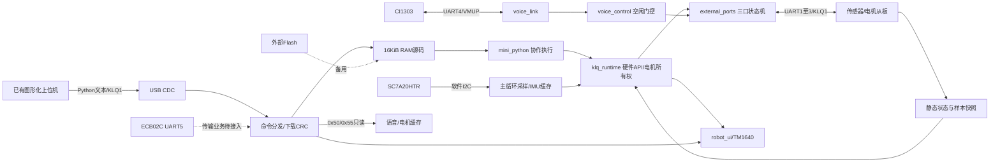

# KLQ机器人当前架构

版本：主机0.13源码，基线codex/python-runtime@8284847；日期2026-10-30。本次更新为代码架构复核，没有操作设备、修改生产代码或升级固件。最近实物记录见[Python电机验收](verification_20261030_python_motor.md)；新发现且尚未修复的问题见[架构检查](architecture_review_20261030.md)。

## 1. 系统与存储边界

- MCU：APM32E103RET6；当前时钟72MHz，16MHz外部晶振，USB48MHz。
- 系统固件包含通信、驱动、解释器和状态服务，写MCU内部Flash；菜单和低电量业务尚未完成。
- Python用户文本仅存16KiB静态RAM。完成/停止/错误后文本保留，可再次RUN；新BEGIN覆盖，MCU复位/断电失效。外部Flash备用，尚未决定用户程序持久化；不把用户程序写内部Flash。
- 上位机已有；机器人暴露Python积木API和下载协议。调度、轮询、驱动和超时由主机固件负责，不要求上位机生成这些内部调用。

## 2. 硬件边界

| 功能 | MCU 接口 | 当前状态 |
| --- | --- | --- |
| 电源保持 | PC5 | 在 C 运行库初始化前拉高，整个运行期间保持高电平 |
| 电源键 | PC4 | 上拉低有效；短按运行／停止、长按 1.5 秒开／关机已接入；菜单确认待实现 |
| 用户按键 | PC3 | 已接入20 ms去抖及wait_button；实物有效电平待验收 |
| USB CDC | PA11 / PA12 | 引导和演示系统固件均已实现并实测 |
| LED 点阵 | PB6 / PB7，TM1640 | 7 行 × 13 列映射、引导图标、开机动画和系统显示状态机已实现；映射方向已实测 |
| 加速度计 | PB8 / PB9，SC7A20HTR | 软件 I²C 驱动、三轴数据和 Roll/Pitch 已实测 |
| 外接端口 1 | PA9 / PA10，USART1 | KLQ1发现、传感器采样、普通电机和排他升级；实际接线重查 |
| 外接端口 2 | PA2 / PA3，USART2 | 同上；最近P2 N20实物验证，接线重查 |
| 外接端口 3 | PB10 / PB11，USART3 | 同上；实际接线需重查 |
| 内置音频 | PC10 / PC11，UART4 | CI1303 VMUP V0.2，版本/音效/语音事件及工程短时运动已接入 |
| ECB02C 蓝牙 | PC12 / PD2，UART5；PA8 连接状态 | UART5 基础初始化完成；连接状态和应用协议未实现 |
| 电池采样 | PA0 ADC | 硬件分配已确定；采样、换算和低电量策略未实现 |
| 外部 Flash | PB12～PB15，SPI | 暂时备用；是否用于用户程序掉电保存尚未决定 |
| USB 插入检测 | PB4 | IO 表标为备用；检测逻辑未实现 |
| SC7 中断 | PB3 / PB5 | INT1/INT2 尚未使用，当前采用周期读取 |
| 调试接口 | PA13 / PA14，SWD | DAPLink 实测可用 |

仅靠 DAPLink 给主机 MCU 供电时，不能据此推定外接端口已正常给传感器供电。2026-09-23 无电池联调中，用户确认传感器未正常供电，三端口均无有效响应；单独给传感器供电后，端口 2 自动识别并连续采样。端口识别测试应先确认传感器电源，详见[外接端口验证记录](verification_20260915_external_ports.md)。

## 3. 固件构建与Flash

同一个bootloader目录中放置共享平台和系统源码，由KLQ_DEMO_APP选择构建边界。文件目录名不是运行层级；build.py当前用glob与BOOT排除名单，后续可收敛为明确源码清单。

| 模式 | 基址 | 行为 |
|---|---|---|
| tools/build.py | 0x08000000 | 最小BOOT、USB、点阵、电源、系统镜像更新 |
| tools/build.py --demo | 0x08008000 | 实际机器人系统固件，含RAM解释器和业务驱动 |

| Flash区域 | 地址 | 大小 |
|---|---|---:|
| BOOT | 08000000..08007FFF | 32KiB |
| 系统APP槽 | 08008000..0807F7FF | 478KiB |
| 镜像元数据 | 0807F800..0807FFFF | 2KiB |

BOOT先使元数据失效，再按连续偏移写APP；END检查CRC和向量，最后提交有效magic。单槽不自动回滚旧APP；失败时留BOOT重新下载。系统APP分支不包含FMC擦写路径，同名BEGIN/DATA/END只操作RAM用户程序。

最近驻留BOOT为0.3；源码BOOT回归为0.4、9984B，没有安装到设备。主APP0.13已经含USB EP RC_W0修复，不能认为驻留BOOT也随之更新。当前USB协议不更新BOOT本身，恢复/安装仍保留SWD通道。

## 4. 启动与电源

SystemInit在C库初始化前拉高PC5。BOOT冷上电要求PC4持续1.5s；软件复位可绕过冷启动门槛。正常通过元数据/CRC/向量检查后跳APP，跳转前关闭USB/SysTick、清NVIC、设置VTOR/MSP。一次性BOOT请求位于RAM顶端2001FFF8，链接器保留最后8B。

系统启动动画后初始化PC4/UART/SC7/USB，进入双眼待机。PC4短按在READY/RUNNING切换运行与停止，空RAM短按显示X；PC3供用户程序等待。长按1.5s先取消用户/语音/升级并请求电机停止，最多150ms后进入关机函数。该函数目前还先等USB断连300ms才拉低PC5，故150ms不是最终GPIO断电上界，属于待优化时序。

USB/DAP可能绕过MOS供电；PC5拉低后MCU未必失电。软件关机循环要求先释放，再新长按1.5s软复位唤醒。电池供电/冷启动电气边界和芯片供电路径必须与软件状态区分。

## 5. 实际主循环与时间约束

当前顺序是：

1. voice_link_poll → protocol_poll → power_key_poll → voice_control_poll。
2. 未读到CI版本时每2s尝试查询；klq_runtime_poll更新用户键。
3. user_program_poll推进一条语句；robot_ui_poll推进显示。
4. 根据Python RUNNING切换外接采样模式；external_ports_poll处理串口与事务。
5. 升级会话活跃时跳过SC7和日志；否则采集IMU、发送调试行/端口摘要。

VM内部跳转预算32、USB接收每次256B，均是工作量预算，不是完整时间预算。USB普通回复可每63B同步等2s；该等待内部只服务电源键和升级外接轮询。INFO又会完整CRC整个APP。因此“协作式”不等于已证明实时上界，这也是架构检查第一批建议的重点。

定时积木从命令入队计时，不从SET ACK开始；API保留协作等待。用户无延时循环合法，不能通过把它判为错误来替代固件调度。

## 6. Python执行与错误

当前实现为直接扫描RAM源码的固定积木语言：字面量参数、固定函数、for/range、while True和pass；循环栈8层，无AST和堆。没有变量、表达式、if、函数或任意模块导入。详细生成约束见[Python API](python_api_v0.1.md)。

END只验证传输CRC；语法和参数错误在RUN时发现，失败停止电机、报告PY_ERROR/PY_LINE、回READY并保留源码。0.13增加拥有电机的3-bit掩码，在处理等待前检测该程序电机的异步错误/离线，报7并全局停机；PENDING/ACTIVE/STOPPING不误报，确认IDLE释放所有权。故障7已有native注入，实际拔线场景尚未验收。

wait_distance/tilt/button目前使用bool等待；距离口离线/IMU失效被当条件未达继续等，健康电机可能继续运行。这是需要明确故障策略的缺口。wait_ir仍未实现，不能因IR已在线就声称所有26项已具备实物功能。每次RUN只停机，不重置功率档位，档位会跨程序继承；是否改默认上下文尚待决定。

## 7. 端口、传感器与电机

- 三个口各自固定RX缓冲、一个未完成事务、CRC/序号/超时/重发现。识别UID/板型/兼容性后才绑定，拔插清缓存。
- 传感器采用后台采集、API读缓存；不是每个Python调用直接进行I2C/UART。见[传感器访问决策](decisions/001_sensor_access_strategy.md)。
- SC7硬件配置100Hz，主机待机读10Hz、Python运行目标50Hz；运行cache有效年龄当前100ms。
- CS100A待机响应后间隔100ms、Python运行响应后40ms；IR响应后20ms。加线时延理论约CS22.5Hz/IR39.1Hz，未含设备处理；不能把间隔参数当实测帧率。距离cache有效年龄当前80ms。
- 当前sample_host_ms使用处理回复的时刻，未区分重复测量和积压回复；已在只读审查复现假新鲜，尚未修复。决策文档的初始25/50ms新鲜度与当前100/80ms也需统一确认。
- 普通电机支持signed PWM±1000，档位1/2/3为333/666/1000，默认2；每约60ms检查身份并刷新。主机旧目标lease150ms，子板软件250ms失联停机。STOP优先，SET超时不重发。
- Python、语音共用普通电机驱动；升级/诊断通过独立会话排他占口，开始时停止用户程序和运动，结束重发现，不自动恢复旧动作。
- 0.13新增只读0x55，读取普通目标/最后ACK/状态而不发UART、不停止设备；ACK不是机械速度。P2 motor_for和motor_run/motor_stop正反已完整实物确认；双电机移动与其他口/低中档机械响应尚未验收。

## 8. 音频与语音

UART4接CI1303，115200/8N1，VMUP独立解析，不与外接KLQ1共用帧。voice_link负责固定缓冲、校验、版本、播放与事件；voice_control负责动作门控。已测试CI0.2.0版本、5000..5007八音效和真实唤醒/正反/停止语义。

工程运动使能默认0，仅RAM；EMPTY/READY且UI待机、已唤醒、版本匹配、恰好一个兼容电机且无升级/关机/复位等占用时，可执行±800最多1s动作。RUNNING期间语音停止会拒绝，不终止用户程序。B0/B2/模式切换丢弃旧意图。当前策略层额外单seq去重存在重启/回绕误拒问题，详见检查报告。

语音事件与系统音效已接入，但语音不在当前26项Python积木里；工程声控不是可直接交付上位机的完整语音积木API。

## 9. USB与PC观测

- USB模式INFO区分KLQ USB BOOT与KLQ ROBOT FW；上位机必须据此区分系统固件更新和RAM文本下载。
- 基本协议见[USB文档](host_usb_protocol_v0.1.md)；0x40..43为排他外接升级，0x50..54为语音工程接口，0x55为普通电机只读缓存。
- Python/普通电机停止、电源关闭、升级取消需保留控制完整性；重复RESET首次TX失败后重试假成功已在本次纯主机复现，尚未修复。
- 观测页由一个CDC worker读取，HTTP仅输出状态。运行CLI前POST/api/pause且released=true，CLI关闭后resume，不能同时抢串口。页面收到合法匹配INFO才在线；电机陈旧快照显示未知。
- 当前传感器仍依赖ASCII日志、工程状态用二进制帧混流。可逐步统一版本化只读快照，将调试输出放低优先级；蓝牙接入前需先设计独立解析和控制/下载所有者。

## 10. 资源与待完成事项

0.13实际APP BIN30952B、RO30884B、RW/ZI27632B，含16KiB源码及2KiB栈；芯片512KiB Flash/128KiB SRAM，见[极海数据手册](https://global.geehy.com/uploads/tool/APM32E103xCxE%20datasheet%20V1.9.pdf)。无动态分配，HEAP512B声明未实际链接。静态调用图可见660B路径，但含未知回调/默认异常循环，不能替代栈水位或完整IRQ最坏情况。

目前的重点是有界调度、事务重试、新鲜度/故障策略和故障恢复；当前资源并不紧张。菜单、电池ADC/低电量策略、蓝牙应用协议、wait_ir、变量/条件语法及实际故障注入/双电机等验收仍待完成。来源与未提交外部资源见当前handoff；整机不能只用单一主机版本号代替各从板/模型构建manifest。
